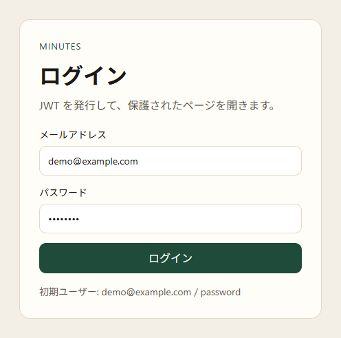
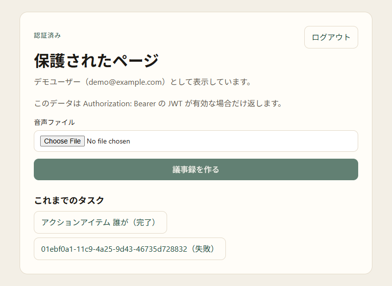
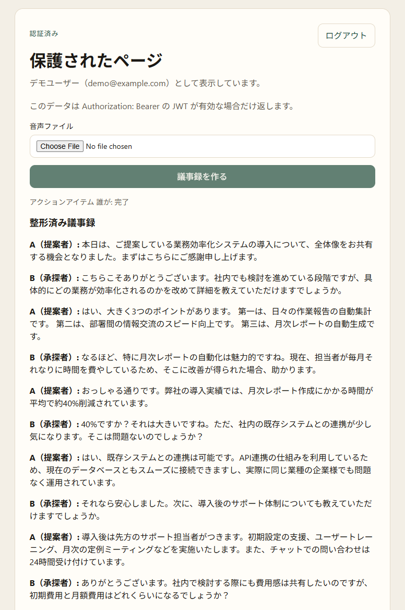
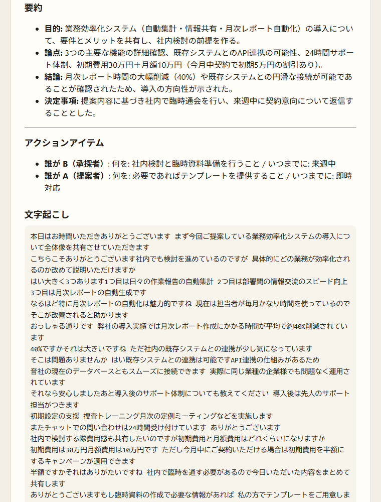
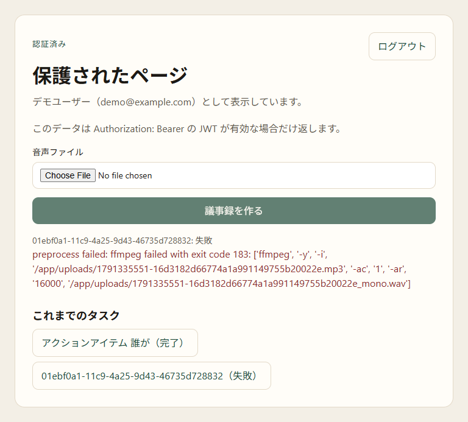

# minutes-ext-access

このリポジトリは、[minutes](https://github.com/plaodas/minutes)（Python / FastAPI）を PHP / Laravel 11 と連携させて利用するための疑似環境です。

- frontend: React
- backend: PHP 8.4、Laravel 11
- db: MySQL
- 認証: JWT Bearer

minutes の呼び出しは [external.md](https://github.com/plaodas/minutes/blob/main/docs/external.md) の仕様に従います。ブラウザは minutes のトークンを持たず、このアプリの API だけを呼びます。

## 構成

```text
.
├── docker-compose.yml          MySQL と Laravel
├── backend/                    PHP 8.4 / Laravel 11
│   ├── app/Http/Controllers/   ログインと minutes のプロキシ
│   ├── app/Services/MinutesClient.php
│   ├── routes/api.php
│   ├── docker/entrypoint.sh    起動時の migrate と seed
│   └── .env                    MINUTES_BASE_URL と MINUTES_PROVISION_SECRET
└── frontend/                   React / Vite
    └── src/
        ├── api.js              Laravel への呼び出し
        ├── auth/               JWT の保持
        └── pages/              ログインと保護されたページ
```

ブラウザの JWT は `frontend` が持ちます。minutes の発行秘密と、ユーザーごとの minutes トークンは `backend` だけが持ちます。

## 起動

minutes を先に起動し、その `PROVISION_SECRET` を `backend/.env` の `MINUTES_PROVISION_SECRET` に書きます。`.env` が無い場合、コンテナ起動時に `.env.example` から作られます。ベース URL の初期値は `http://host.docker.internal/api` です。

```bash
docker compose up --build
```

MySQL と Laravel が起動します。Laravel は http://localhost:8000 です。別ターミナルでフロントエンドを起動します。

```bash
cd frontend
npm install
npm run dev
```

ブラウザで http://localhost:5173 を開きます。`/api` は Vite が `http://localhost:8000` へ転送します。

初回ログインのユーザーは seed で作られます。

- メールアドレス: `demo@example.com`
- パスワード: `password`

テストは次のコマンドです。

```bash
docker compose run --rm backend php artisan test
```

Composer の security audit が現行の Laravel 11 をブロックするため、`backend/composer.json` では `audit.block-insecure` を `false` にしています。

## 使用方法

1. ログインすると、JWT で保護されたページが開きます。

   

2. 音声ファイルを選び「議事録を作る」を押します。対応形式は `.wav`、`.mp3`、`.m4a`、`.flac`、`.ogg`、`.opus`、または `audio/` です。
3. 「これまでのタスク」にタスクが追加されます。処理中は `stage` をポーリングし、待機、前処理、文字起こし、整形、完了、失敗、キャンセル済みのいずれかで表示します。一覧の各行にはエラー文を出しません。

   

4. 完了したタスクを開くと、`result.minutes` を Markdown で表示します。ここには整形済み議事録、要約、アクションアイテムが含まれます。文字起こしは `result.transcript` をプレーンテキストで表示します。

   

   

5. 失敗したタスクを開くと、そのタスクのエラーを表示します。

   

## このアプリの API

ログインで受け取った `access_token` を、以降のリクエストに付けます。

```http
Authorization: Bearer <access_token>
```

| Method | Path | 認証 | 内容 |
| --- | --- | --- | --- |
| POST | `/api/login` | 不要 | ログイン。`access_token` を返す |
| GET | `/api/me` | Bearer | ログイン中のユーザー |
| POST | `/api/logout` | Bearer | ログアウト |
| GET | `/api/dashboard` | Bearer | 保護されたページの表示データ |
| GET | `/api/minutes/tasks` | Bearer | タスク一覧 |
| POST | `/api/minutes/tasks` | Bearer | 音声を multipart の `file` で送る。`task_id` を返す |
| GET | `/api/minutes/tasks/{taskId}` | Bearer | `stage` を返す |
| GET | `/api/minutes/tasks/{taskId}/result` | Bearer | `stage` が `success` の結果 |

音声の拡張子は `.wav`、`.mp3`、`.m4a`、`.flac`、`.ogg`、`.opus`、または `audio/` の Content-Type です。

## minutes 側の endpoint

Laravel が [external.md](https://github.com/plaodas/minutes/blob/main/docs/external.md) に基づいて呼ぶ endpoint です。ベース URL は `MINUTES_BASE_URL`（末尾は `/api`）です。

| Method | Path | 認証 | このアプリの対応 |
| --- | --- | --- | --- |
| POST | `/api/external/users` | `MINUTES_PROVISION_SECRET` | 初回利用時と、401 `Not authenticated` のときにユーザーとトークンを発行する |
| POST | `/api/transcribe-upload-bg` | 保存した minutes トークン | `POST /api/minutes/tasks` |
| GET | `/api/bg/tasks` | 保存した minutes トークン | `GET /api/minutes/tasks` |
| GET | `/api/bg/status/{task_id}` | 保存した minutes トークン | `GET /api/minutes/tasks/{taskId}` |
| GET | `/api/bg/result/{task_id}` | 保存した minutes トークン | `GET /api/minutes/tasks/{taskId}/result` |

進捗の SSE（`GET /api/bg/events`）は使いません。状態は status のポーリングで見ます。

本文だけの取得 endpoint（`GET /api/bg/minutes/{task_id}`、`GET /api/bg/transcript/{task_id}`、`GET /api/bg/summary/{task_id}`、`GET /api/bg/action-items/{task_id}`）は呼びません。整形済み議事録、要約、アクションアイテムは `result.minutes` を表示し、文字起こしは `result.transcript` を表示します。
